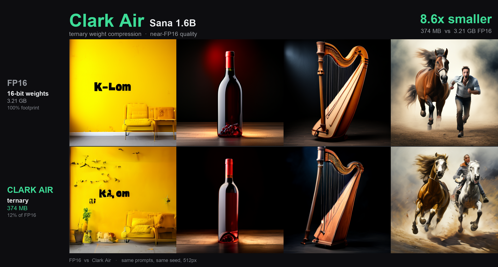
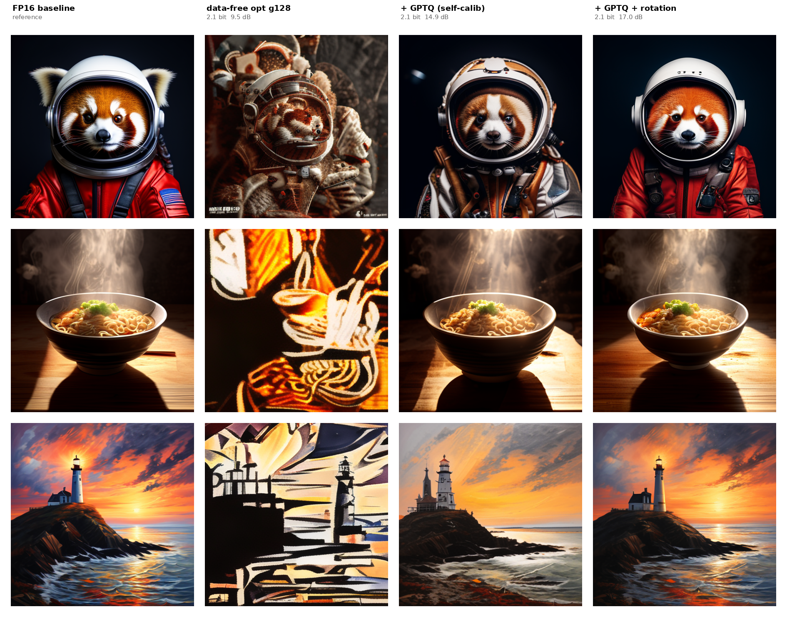

# Clark Air

Research notes, protocols, negative results, and execution receipts are preserved
in the [experiment registry](experiments/README.md). Start with the
[LLM ternary research dossier](experiments/llm_ternary_158bit_dossier/README.md),
[Swin2SR dossier](experiments/swin2sr_super_resolution_1_58bit/README.md),
[Sana dossier](experiments/sana_image_generation_158bit_dossier/README.md), or
[OmniVoiceGraph benchmark notes](experiments/omnivoicegraph_moss_bench/README.md).
Model payloads, raw datasets, credentials, and machine-local staging files stay
outside Git; artifact indexes record the relevant hashes and locations.

**Low-bit weight compression for image-generation models.** **Clark Air** packs a
Sana 1.6B diffusion transformer down to **ternary (~1.85 bits/weight)** — **8.6×
smaller than FP16 at near-FP16 quality** (374 MB vs 3.21 GB).



*FP16 (top) vs **Clark Air** (bottom) — Sana 1.6B, identical prompts and seed.*

## Clark Air Sana 1.6B

| Artifact | Size | vs FP16 | What it is |
|---|---|---|---|
| FP16 transformer | 3.21 GB | 1× (100%) | bf16 safetensors |
| **Clark Air — packed** | **374 MB** | **8.6× (≈12%)** | packed ternary `safetensors` |
| Clark Air — unpacked | 3.21 GB | compatibility | dequantized bf16 safetensors (drop-in `diffusers`) |

Measured at **~1.85 bits/weight** → **8.6× smaller** (374 MB vs 3.21 GB). The
**unpacked** safetensors is a drop-in `diffusers` compatibility format — it is *not*
the compressed footprint; the **packed** 374 MB `safetensors` is the real on-disk
artifact.

> **Naming.** **Clark Air** is the productized algorithm and model line. The earlier
> research names **Clark-Quantize** / **Clark-Compress** refer to the data-free PTQ
> method documented below — the initialization that Clark Air's QAT builds on.

---

## Foundation: data-free Clark PTQ

**Data-free, optimal-scale ternary (1.58-bit) post-training quantization for
generative transformers.**

**Headline result:** data-free, train-free, **near-FP16 quantization is solved for
the attention/projection layers** of a diffusion transformer at 1.7–2.1 bits — and
**the GLU-conv FFN is the remaining compression bottleneck** (a systematic negative
result for scalar ultra-low-bit coding). The shipped product is mixed-precision
(ternary attention + 4-bit FFN): **near-FP16, ~4–6× smaller, zero external data.**

Three ideas get attention to near-FP16, all with **no dataset, no gradients, no
fine-tuning**:

1. **Optimal-scale ternary** (data-free floor): `absmean` → noise; the MSE-optimal
   scale → recognizable.
2. **GPTQ + shared incoherence rotation** → near-FP16 at 2.1 bits.
3. **Noise+null self-calibration** (the core unlock): the GPTQ Hessian is captured
   from the model's *own* unconditional prior (Gaussian noise + the null prompt a
   diffusion model already consumes) — matching prompt-calibration to within noise
   (16.1 vs 15.9 dB) with no external data at all.

The full progression at the **same 2.1-bit budget** (Sana 1.6B, identical seed):



*Left→right: FP16 baseline · data-free optimal scale (9.5 dB, noise) · + GPTQ
self-calibration (14.9 dB) · + incoherence rotation (17.0 dB, near-FP16).*

## The one idea that matters: the scale

Ternary quantization stores `w_i ≈ s_g · t_i`, `t_i ∈ {-1,0,+1}`, with one scale
`s_g` per group. The quality is decided **entirely by how `s_g` and the ternary
support are chosen.** The popular `absmean` rule (`s = mean|w|`) produces *noise*
on a diffusion trunk. Choosing the **MSE-optimal** scale instead recovers the
image.

For a group, minimizing `Σ (w_i − s·t_i)²` over the support `S` (which weights are
±1) and the scale `s` has a closed form:

```
s* = mean_{i∈S} |w_i|,   and the optimal support of size k is the top-k by |w_i|.
```

so choosing `k` reduces to **maximizing `(Σ_{top-k}|w_i|)² / k`** — a data-free,
`O(g log g)` per-group computation. That single change is the difference between
the middle/right images above and pure static.

```python
import torch
from clark_quantize import quantize_module
from diffusers import SanaPipeline

pipe = SanaPipeline.from_pretrained("Efficient-Large-Model/Sana_1600M_512px_diffusers",
                                    torch_dtype=torch.bfloat16)
quantize_module(pipe.transformer, group=32, method="optimal")   # data-free
pipe.enable_model_cpu_offload()
pipe("a bowl of ramen, steam rising, photoreal").images[0].save("ramen.png")
```

## Results (Sana 1.6B, 512px, 20 steps, 3 prompts, seed 0)

| Method | data | eff. bits/wt | PSNR vs FP16 ↑ | outcome |
|---|---|---|---|---|
| `absmean`, g128 | none | 2.1 | 9.08 dB | noise |
| error-feedback, g128 | none | 2.1 | 9.38 dB | noise |
| **optimal scale, g128** | **none** | 2.1 | 9.52 dB | recognizable |
| **optimal scale, g32** | **none** | 2.5 | 12.01 dB | near-baseline |
| **+ GPTQ, g128** | self | 2.1 | 14.91 dB | good |
| **+ GPTQ, g32** | self | 2.5 | 16.53 dB | strong |
| **+ GPTQ + rotation, g128** | self | **2.1** | **17.01 dB** | **near-FP16** |

All variants keep only **6 tiny layers** (adaptive-norm modulation, text/time
conditioning, final projection — 5.4% of params) at original precision. "self"
means self-calibrated on the model's own generations — no external dataset. The
**noise+null** variant (Hessian from Gaussian noise + the empty prompt) matches
this exactly with *no prompts at all*: **16.1 vs 15.9 dB** — fully data-free.

## The FFN bottleneck (a negative result)

Attention is solved; **Sana's gated GLU-conv FFN (47% of params) resists scalar
ultra-low-bit coding.** Framing it as rate–distortion (attention fixed at trit
1.71 b), measuring *true symbol-entropy* bits:

| FFN format | eff. bits | PSNR vs FP16 |
|---|---|---|
| scalar ternary | 0.87 | 10.8 |
| uniform 5-symbol | 1.73 | 13.3 |
| uniform 7-symbol | 2.25 | 14.6 |
| **4-bit (shipped)** | **3.4** | **16.2** |
| post-hoc sparse escapes | 1.24 | 9.0 (✗ breaks GPTQ) |
| learned Lloyd–Max EC-7 | 2.52 | 14.9 (entropy ↑) |
| entropy-constrained GPTQ @1.8b | 1.81 | 8.1 (✗) |

**Every scalar method tested** — optimal ternary, uniform multi-symbol, learned
Lloyd–Max, post-hoc escapes, and entropy-constrained GPTQ — **fails to reach a
near-FP16 point below ~2 bits on this FFN.** The failure mode (a global scalar rate
objective drives most coordinates to 0 and spends a few on big escapes, destroying
per-group amplitude uniformity) indicates the missing information is **local and
vector-structured**, not scalar — pointing to vector quantization (PVQ/TCQ/lattice)
or structural GLU channel contraction. We do not claim a formal lower bound.

So the practical product is **mixed precision**: ternary attention + **4-bit FFN**,
data-free, near-FP16, ~4–6× smaller. See `paper/` for the full account.

**Why activation-aware wins.** The optimal scale minimizes `‖W − Wq‖` (per
weight); what the network needs is `‖(W − Wq)x‖` (per output). GPTQ retargets the
objective by pushing each column's rounding error onto not-yet-quantized columns
via `H⁻¹` (`H = Σ xxᵀ`). The incoherence rotation `R` (`W→WRᵀ`, `x→xRᵀ`, exact)
then spreads outliers so one group scale suffices — a single shared `R` serves all
164 same-width layers and the Hessian rotates analytically (`H→RHRᵀ`). See
[`paper/clark-quantize.tex`](paper/clark-quantize.tex).

## Repository layout

```
clark_quantize/ternary.py        data-free optimal-scale ternary (+ ablations)
clark_quantize/gptq.py           activation-aware: GPTQ + incoherence rotation
scripts/quantize_sana.py         data-free quantize + generate
scripts/quantize_sana_gptq.py    activation-aware quantize + generate (self-calib)
scripts/make_montage.py          labelled before/after comparison grids
assets/                          before/ (FP16) and after/ example images
paper/clark-quantize.tex         technical paper: derivation + results + PDF
```

## Reproduce

```bash
pip install -r requirements.txt

# data-free tier
python scripts/quantize_sana.py --mode fp16            --tag fp16        # baseline
python scripts/quantize_sana.py --method optimal --group 32  --tag opt_g32

# activation-aware tier (near-FP16 at 2.1 bits) -- self-calibrated, no dataset
python scripts/quantize_sana_gptq.py --group 128 --rotate --tag gptqrot_g128

python scripts/make_montage.py --out assets/compare.png \
    fp16:"FP16 baseline" gptqrot_g128:"Clark-Quantize 2.1-bit"
```

Fits a single 24 GB GPU (CPU offload enabled). Quantization is "fake" (weights
are replaced by their dequantized ternary values in bf16), which isolates the
*algorithm's* quality impact; production deployment would pack the weights and
use 2-bit kernels.

## License

Apache-2.0 © Clark Labs, Inc.
