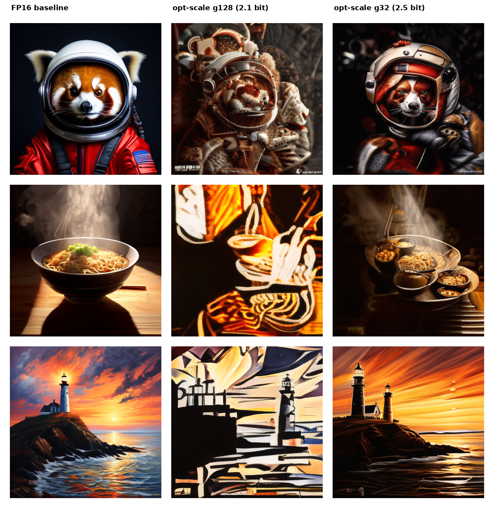

# Clark-Quantize

**Data-free, optimal-scale ternary (1.58-bit) post-training quantization for
generative transformers.**

Clark-Quantize compresses the matrix-heavy weights of a transformer to
`{-1, 0, +1}` with a single FP16 scale per group of weights — **no calibration
data, no gradients, no fine-tuning** — and still generates coherent images from a
diffusion model whose trunk is 94.6% ternary.

The whole story in one figure (Sana 1.6B, identical prompts and seed):



*Left: FP16 baseline. Middle: Clark-Quantize ternary at group 128 (2.1 bits/wt).
Right: group 32 (2.5 bits/wt). Both are fully data-free.*

## The one idea that matters: the scale

Ternary quantization stores `w_i ≈ s_g · t_i`, `t_i ∈ {-1,0,+1}`, with one scale
`s_g` per group. The quality is decided **entirely by how `s_g` and the ternary
support are chosen.** The popular `absmean` rule (`s = mean|w|`) produces *noise*
on a diffusion trunk. Choosing the **MSE-optimal** scale instead recovers the
image.

For a group, minimizing `Σ (w_i − s·t_i)²` over the support `S` (which weights are
±1) and the scale `s` has a closed form:

```
s* = mean_{i∈S} |w_i|,   and the optimal support of size k is the top-k by |w_i|.
```

so choosing `k` reduces to **maximizing `(Σ_{top-k}|w_i|)² / k`** — a data-free,
`O(g log g)` per-group computation. That single change is the difference between
the middle/right images above and pure static.

```python
import torch
from clark_quantize import quantize_module
from diffusers import SanaPipeline

pipe = SanaPipeline.from_pretrained("Efficient-Large-Model/Sana_1600M_512px_diffusers",
                                    torch_dtype=torch.bfloat16)
quantize_module(pipe.transformer, group=32, method="optimal")   # data-free
pipe.enable_model_cpu_offload()
pipe("a bowl of ramen, steam rising, photoreal").images[0].save("ramen.png")
```

## Results (Sana 1.6B, 512px, 20 steps, 3 prompts, seed 0)

| Method | eff. bits/wt | % params ternary | PSNR vs FP16 ↑ | outcome |
|---|---|---|---|---|
| `absmean`, g128 | 2.1 | 94.6 | 9.08 dB | noise |
| error-feedback, g128 | 2.1 | 94.6 | 9.38 dB | noise |
| **optimal, g128** | **2.1** | **94.6** | **9.52 dB** | recognizable |
| **optimal, g32** | **2.5** | **94.6** | **12.01 dB** | **near-baseline** |

Only **6 tiny layers** (adaptive-norm modulation, text/time conditioning, final
projection — 5.4% of params) are kept at original precision; everything else is
ternary. Error feedback and per-row gain correction were tested and did **not**
help (error feedback hurt). See [`paper/clark-quantize.tex`](paper/clark-quantize.tex).

## Repository layout

```
clark_quantize/ternary.py   core algorithm (optimal-scale ternary + ablations)
scripts/quantize_sana.py    quantize a Sana transformer and generate images
scripts/make_montage.py     build labelled before/after comparison grids
assets/                     before/ (FP16) and after/ (ternary) example images
paper/clark-quantize.tex    short technical paper with the derivation + results
```

## Reproduce

```bash
pip install -r requirements.txt
python scripts/quantize_sana.py --mode fp16            --tag fp16        # baseline
python scripts/quantize_sana.py --method absmean --group 128 --tag absmean  # noise
python scripts/quantize_sana.py --method optimal --group 32  --tag opt_g32   # best
python scripts/make_montage.py --out assets/compare_final.png \
    fp16:"FP16 baseline" opt_g32:"Clark-Quantize g32"
```

Fits a single 24 GB GPU (CPU offload enabled). Quantization is "fake" (weights
are replaced by their dequantized ternary values in bf16), which isolates the
*algorithm's* quality impact; production deployment would pack the weights and
use 2-bit kernels.

## License

Apache-2.0 © Clark Labs, Inc.
